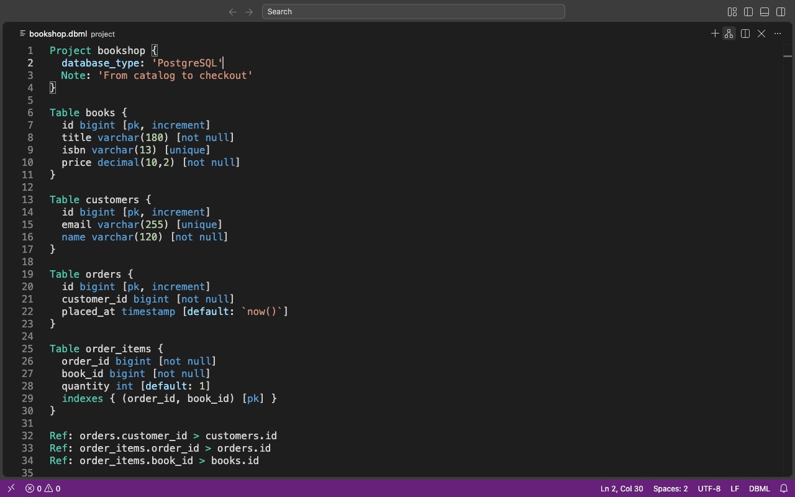
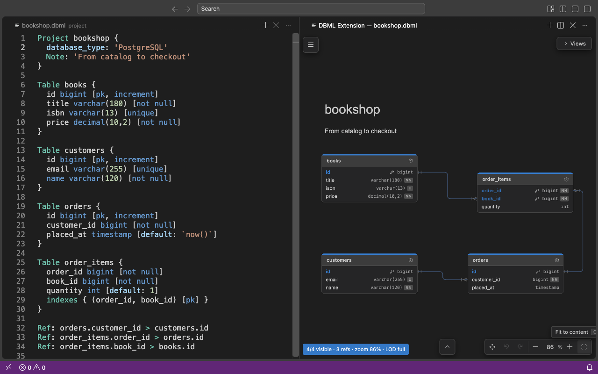
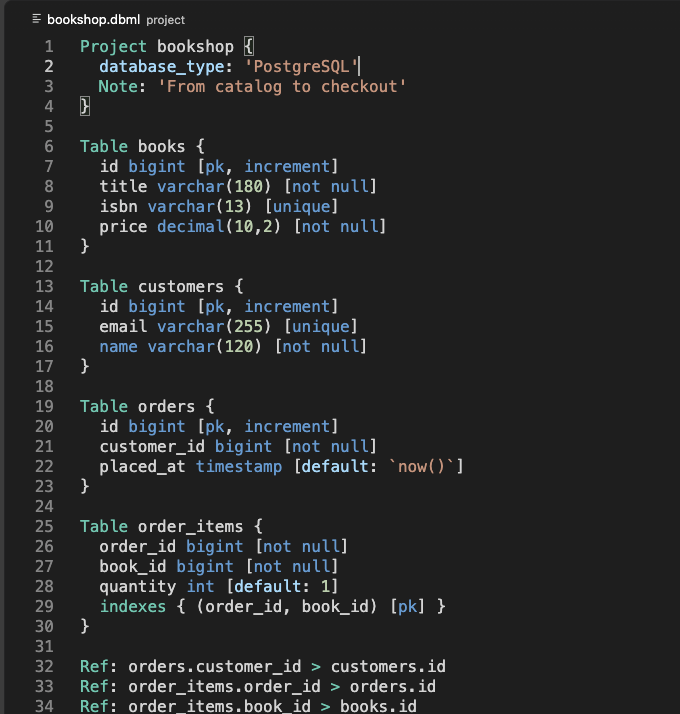

# DBML Extension — DBML diagrams for VS Code, Git-friendly, DDD-aware

[GitHub repository](https://github.com/janar153/dbml-extension) · [Report an issue](https://github.com/janar153/dbml-extension/issues)

DBML Extension is an independently maintained fork of [dddbml by TWulfZ](https://github.com/TWulfZ/dddbml). See [LICENSE](LICENSE) for the original MIT license and copyright notice.

Editor language support adapts [vscode-dbml by Matthew Meyers](https://github.com/mattmeyers/vscode-dbml). See its [MIT license and copyright notice](THIRD-PARTY-LICENSE-vscode-dbml.txt).

Interactive diagram for `.dbml` files, rendered beside the editor. The **source of truth stays in your `.dbml`**: you write it in the editor, and the diagram only applies small, minimal text edits when you ask for them (new table, new FK, delete). Table positions, group colors and edge shapes live in a sibling JSON file with deterministic formatting, so your team reviews the diagram in the same PR as the schema.

## DBML in action



### Side-by-side diagram



### DBML syntax highlighting



Built for:

- **DDD projects** — every `TableGroup` is a bounded context you can hide, collapse or color.
- **Large schemas** — viewport culling + level of detail keep pan/zoom smooth on thousands of tables.
- **Git-based teams** — sorted keys, integer coordinates, no view-state noise; conflicts on the layout file are resolved inside the diagram.

## Install

Run `pnpm run package` from the repository root to build a VSIX in `packages/`.
The five most recently built release archives are retained, including releases
from before the rename. Rebuilding the same version replaces its archive.

```bash
code --install-extension packages/dbml-extension-<version>.vsix
```

Open a `.dbml` file and run **`DBML Extension: Open Diagram`** (command palette or the editor-title icon).

If you are switching from dddbml, copy any customized VS Code settings from `dddbml.*` to `dbml-extension.*` and update any custom keybindings that reference the old command IDs. Existing DBML and layout files work with DBML Extension.

## Features

**DBML editor**

- Native syntax highlighting for `.dbml` files, with line and block comments, bracket matching, auto-closing pairs, and snippets for common declarations. The grammar covers database structure, diagram views and metadata, lineage, architecture, and module syntax.
- Open the diagram beside the editor with **DBML Extension: Open Diagram**. In trusted workspaces, live diagrams resolve `use` and `reuse` across local DBML files and refresh when a dependency is saved. Modules must stay within the containing workspace folder, or the entry file's folder when opened on its own.
- Multi-file rendering is available in the live diagram. Source edits, SQL export, and Git revision views still use their existing single-file paths. Edit imported definitions in the source editor.

**Canvas**
- Tables, refs and groups parsed with the official `@dbml/core` in a background worker; tables with no saved position are arranged by bounded context.
- Pan by left-dragging empty canvas when no tables are selected. Middle-click, `Space` + drag, and the hand tool also pan. Zoom with the wheel, `Ctrl+=` / `Ctrl+-`, fit with `Ctrl+1`, reset with `Ctrl+0`.
- Drag tables; use `Shift` + drag on empty space to box-select or add to a selection (`Esc` clears it). With tables selected, ordinary empty-space dragging also box-selects. Undo/redo with `Ctrl+Z` / `Ctrl+Shift+Z`.
- Two detail levels by zoom: full tables, or colored rectangles for a bird's-eye view (threshold configurable).
- Double-click a table header (or a column) to jump to its declaration in the `.dbml`; `Ctrl`+click anywhere in a `Table` block in the editor to focus it in the diagram.

**Relationships**
- Orthogonal edges that leave and enter at the FK/PK column rows, with crow's-foot / bar cardinality markers. Like dbdiagram, edges always leave from the left/right sides: a Z across a wide gap, an S when the tables are close, and a C around the right side once they overlap. Self-references draw as nested loops.
- Edit an edge by sliding a segment or dragging a ghost handle to add a notch; drag an endpoint to any position along the left, right, top, or bottom table border; recolor; "Reset line" to tidy.
- **Auto-arrange** (whole diagram or the selection) with an obstacle-avoiding edge router, cancelable with real progress.

**Assisted editing** (writes your `.dbml` with minimal edits; `Ctrl+Z` in the diagram undoes them)
- Right-click empty canvas → **New table here**: name it and it appears where you clicked (inside a group box it joins that `TableGroup`).
- Right-click a table → **Add field** opens the editor on a new line in that table.
- Drag the dot on a column's right edge onto another column to create a reference, then pick the cardinality.
- Delete a table, a field or a relation from its context menu, with a confirmation listing what else goes with it.
- Tip: enable VS Code **Auto Save** so the diagram and the file stay in sync.

**DBML `records` and `Dep`**
- Tables with sample `records` show a row-count badge; click it for a read-only grid of the values.
- `Dep` blocks (`Dep: a -> b`, `Dep: a.col -> b.col`) draw as dashed curved arrows, separate from FK refs. Select one to add, move (drag) or delete (double-click) bend points; toggle them in **Diagram Views → Dependencies**.

**Bounded contexts (`TableGroup`)**
- Dashed container per group; collapse to a single node with aggregated edges; hide a group or a single table.
- Per-group, per-table and per-edge colors from a palette, or any color via the eyedropper chip.
- **Diagram Views** panel: search, hide/show all, collapse/expand all, per-table visibility.

**Git, from the canvas**
- Commit, discard or stash the diagram files only (`.dbml` + layout); browse history read-only; overlay a diff vs HEAD with inline column changes.
- Layout-file merge conflicts are resolved in-diagram with ghost positions, never by hand-editing markers.

**Export**
- Schema → **TypeORM entities** (PostgreSQL dialect; more dialects pluggable). Export the whole schema or the selection.
- Schema → **PostgreSQL SQL script**. Choose **PostgreSQL (SQL)** in **Export Schema** to save a `.sql` file containing the full schema, including keys, constraints, indexes, and enums.
- Diagram → **PNG / SVG / clipboard**, whole diagram, current view or selection. Prefer SVG for very large diagrams.

**Settings** — zoom step and limits, LOD threshold, UI density, snap-to-grid, layout spacing and export defaults, editable from the in-app Settings panel or VS Code settings (`dbml-extension.*`).

## Layout file

For `schema.dbml` the extension writes `schema.dbml.layout.json` next to it:

```json
{
  "version": 1,
  "tables": {
    "public.orders": { "x": 480, "y": 80 },
    "public.users": { "x": 120, "y": 80, "color": "#8b5cf6" }
  },
  "groups": {
    "billing": { "color": "#D0E8FF" }
  },
  "edges": {
    "public.orders::user_id|public.users::id": {
      "waypoints": [{ "x": 360, "y": 120 }]
    }
  }
}
```

Only shared design goes into this file. Your camera position and which groups you hid or collapsed are per-user view state, stored in VS Code's global storage, so pan/zoom never dirties the repo. The writer sorts keys, rounds coordinates to integers, omits defaults, uses LF + trailing newline and writes atomically. Moving three tables changes three lines.

## Design vs data

Keep the `.dbml` about **data** (tables, columns, refs, `records`, `Dep`) and let the layout file carry **design** (positions, colors, bend points). A DBML `headercolor` is honored as a fallback, but it is never copied into the layout file: the moment you pick a table color in the diagram, the layout color wins and DBML Extension shows a one-time notice. Choosing colors in the UI keeps diagram tweaks out of your schema diffs and lets several people restyle the diagram without touching the source of truth.

## Commands

| Command | Effect |
|---|---|
| `DBML Extension: Open Diagram` | Open the diagram beside the active `.dbml`. |
| `DBML Extension: Auto-arrange Diagram…` | Smart layout (all / new / selection) with edge ordering. |
| `DBML Extension: Export Schema…` | Export TypeORM entities or a PostgreSQL SQL script. |
| `DBML Extension: Export Image…` | PNG / SVG / clipboard export. |
| `DBML Extension: Reset Layout` | Drop saved positions and re-run auto-layout. |
| `DBML Extension: Prune orphan layout entries` | Remove layout entries whose table or group no longer exists. |
| `DBML Extension: Zoom In / Zoom Out / Reset View / Fit to Content` | Viewport commands, bound to the shortcuts above while the diagram is focused. |

Drag a database dependency line or an architecture link to add a bend. Click the line to reveal its handles, drag a handle to reposition it, or double-click it to remove the bend. Drag either endpoint handle to move the attachment around the node or table. Bends and attachments are saved in the layout sidecar. Select or right-click a line for **Reset line** and **Edge color**.

## System architecture diagrams

Set `diagram_type: arch` in the front matter and open the file with **DBML Extension: Open Diagram**.

```dbml
---
diagram_type: arch
title: Orders platform
---
Internet clients
Server "Orders API" as api
Database "Orders database" as db [type: 'postgres']
Group Production { api db }
Link: clients > api [proto: HTTPS, host: 'api.example.test']
Link: api > db
```

Edit nodes, links, groups, and notes in the DBML source. The canvas arranges them automatically and saves manual positions in the adjacent `.dbml.layout.json`. Drag a group to move its contents together. Use **Export Image** for SVG or PNG, including printer-friendly output.

For custom node icons, use an image filename beside the DBML file or an embedded image data URI. Remote icon URLs use the role's default symbol.

See the [DBML system architecture syntax](https://dbml.dbdiagram.io/syntax/system-architecture/).

## Limitations

- The diagram reflects the last **saved** file; editing happens in the text editor.
- One `.dbml` per diagram — `!include` is not followed yet.
- Self-referencing refs render degenerately.

See `specs/08-roadmap.md` for what is planned.

## Development

```bash
pnpm install
pnpm build            # extension (esbuild) + webview (vite)
pnpm test             # vitest
pnpm typecheck
```

Run `pnpm test:perf` on an idle machine to check the absolute drag-frame and A* routing budgets against `huge.dbml`. The regular suite runs the same cases and checks correctness and relative drag speedups.

Press `F5` to launch an Extension Development Host, open a `.dbml` there (e.g. `test/fixtures/huge.dbml`, 5000 tables) and run the command. `pnpm watch:extension` / `pnpm watch:webview` rebuild on change.

- `src/extension/` — VS Code host: parsing, layout file I/O, git, exporters, panel lifecycle.
- `src/webview/` — Preact + Zustand renderer: culling, LOD, edges, drag, panels.
- `src/shared/` — types crossing the `postMessage` boundary.
- `specs/` — design documents (Spanish). If you change a pipeline, update its spec in the same PR.

Performance budgets and how to measure them: `specs/07-performance-budgets.md`.

## License

MIT. See `LICENSE`.


### DBML compatibility

Parsing uses the official `@dbml/core` v12 parser and its DBML v2 grammar. Tables render the resolved columns from TablePartials, quoted identifiers and types, enum-typed columns, column constraints, notes, and defaults. Composite primary keys are marked on every member column. Records have a read-only preview.

References support inline, short, and long forms; `>`, `<`, `-`, and `<>`; and `?` on either or both sides. Endpoints use standard crow’s-foot notation: double bars for exactly one, a bar plus a crow’s foot for one or many, and a circle plus a bar/crow’s foot for zero or one/many. The crow’s foot spreads toward the table. Schema-qualified names, aliases, composite column lists, multiple inline refs, and self-references are supported. DBML ref colors apply unless a saved diagram color overrides them. Hover an unselected relationship to inspect its name, columns, cardinality, and delete/update actions. SVG and raster exports use the same relationship markers and colors.

Standalone enum definitions and index/check definitions remain in the DBML source. Injected partial columns and index primary keys affect the displayed tables.

Syntax reference: [official DBML documentation](https://dbml.dbdiagram.io/docs/).

## CI and releases

Pull requests targeting `main` generate test fixtures, type-check, run the test
suite, and build and verify the VSIX. Require the **Validate extension** check
in the GitHub rules for `main` to block merges while validation is pending or
failing.

Updates to `main` repeat those checks and publish a GitHub release with the
validated VSIX for a new version in `package.json`. The workflow publishes the
same release asset to the VS Code Marketplace and skips versions already
published there. Bump the version in `package.json` for each release.

Before the first Marketplace release, sign in to
[Manage Publishers & Extensions](https://marketplace.visualstudio.com/manage)
and create the publisher with ID `janar153` if you don't already own it. Under
**Trusted Publishing**, create a policy with repository owner `janar153`,
repository `dbml-extension`, workflow `extension.yml`, and an empty environment
field. GitHub Actions authenticates with OIDC and needs no Marketplace secret.
See the [Trusted Publishing guide](https://code.visualstudio.com/api/working-with-extensions/publishing-extension#publish-with-github-actions-and-trusted-publishing).

Whenever you set or change the extension version in `package.json`, run
`pnpm run package` and verify the resulting
`packages/dbml-extension-<version>.vsix` with `unzip -t` before opening or
updating the release PR.
